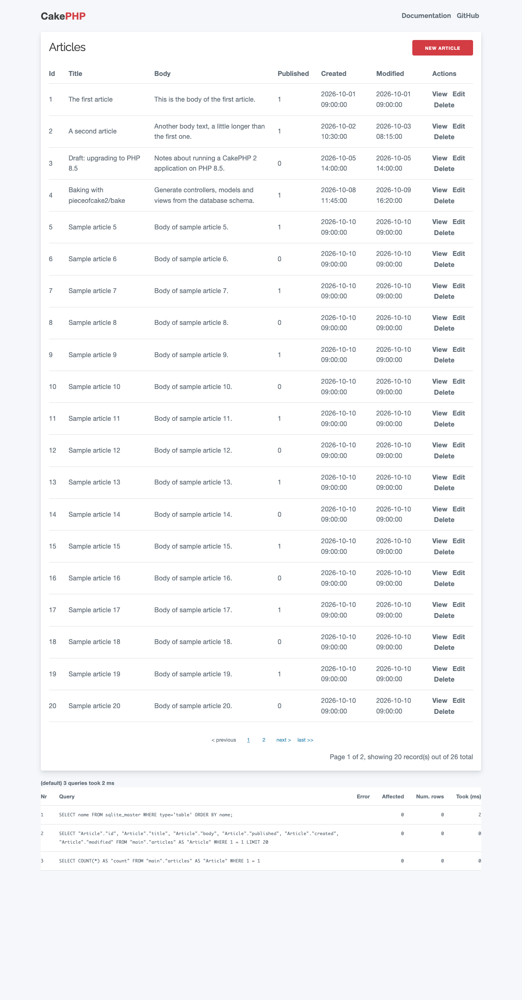
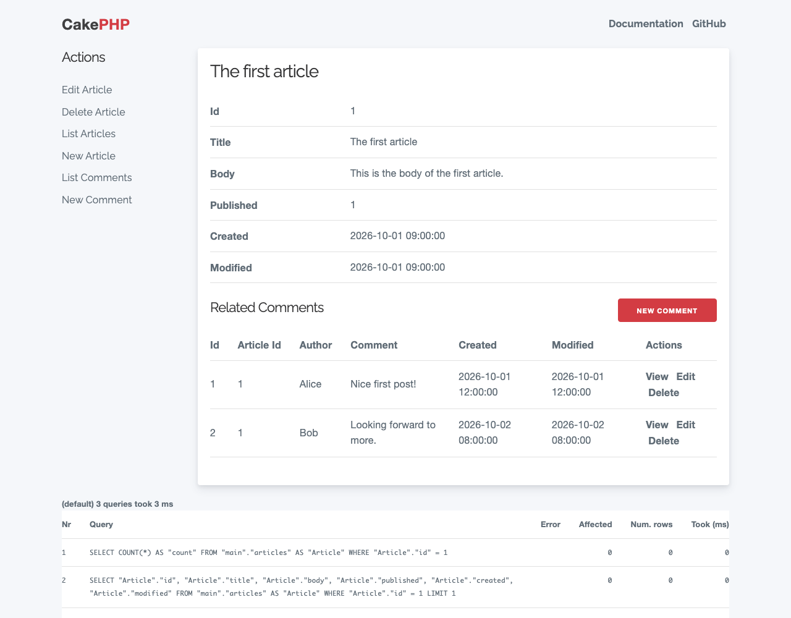
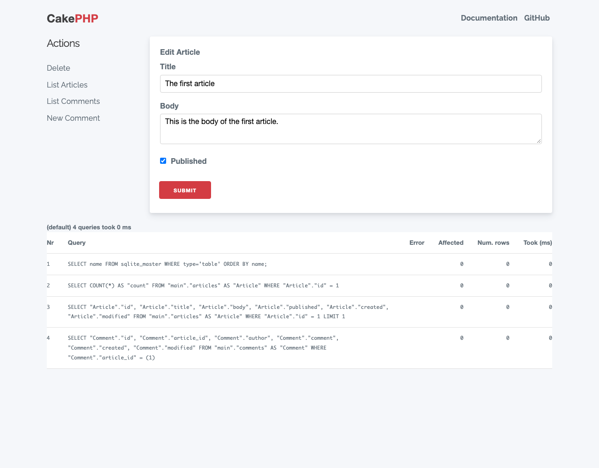

# Bake ドキュメント

Bake プラグインは `bake` コンソールシェルを提供します。このシェルは、
[pieceofcake2/cakephp](https://github.com/pieceofcake2/cakephp) で動作する CakePHP 2 アプリケーションのモデル、
コントローラー、ビュー、フィクスチャ、テスト、プラグイン、プロジェクトを生成します。CakePHP 2 のクックブックの
[Bake でコード生成](https://pieceofcake2.github.io/docs/ja/console-and-shells/code-generation-with-bake.html)
も参照してください。

- [インストール](#installation)
- [Bake の実行](#running-bake)
- [コマンド](#commands)
- [オプション](#options)
- [Bake テーマ](#bake-themes)
- [bake したビューと legacy テーマ](#baked-views-and-the-legacy-theme)

<a id="installation"></a>

## インストール

[Composer](https://getcomposer.org/) で、開発用の依存パッケージとしてプラグインをインストールします。
[pieceofcake2/app](https://github.com/pieceofcake2/app) スケルトンから作成したアプリケーションには、すでに含まれています。

```bash
composer require --dev pieceofcake2/bake
```

このプラグインは `cakephp-plugin` タイプなので、`composer/installers` によってプラグインのディレクトリに
インストールされます。正しい場所にインストールされるように、アプリケーションの `composer.json` で
`installer-paths` を設定してください。

| 構成 | `installer-paths` |
| --- | --- |
| モダン (`config/`、`src/`、`templates/`、`plugins/`) | `"plugins/{$name}/": ["type:cakephp-plugin"]` |
| レガシー (`app/Config/`、`app/Plugin/`) | `"app/Plugin/{$name}/": ["type:cakephp-plugin"]` |

プラグインは `config/bootstrap.php` (レガシー構成では `app/Config/bootstrap.php`) で読み込みます。
すでに `CakePlugin::loadAll()` を使っている場合は必要ありません:

```php
CakePlugin::load('Bake');
```

Bake は開発用の依存パッケージなので、`composer install --no-dev` でデプロイした環境にはインストールされません。
インストールされていないプラグインを読み込むと `MissingPluginException` が投げられるので、インストールされている
環境でだけ読み込んでください。たとえば次のようにします。

```php
if (Configure::read('debug')) {
    CakePlugin::load('Bake');
}
```

<a id="running-bake"></a>

## Bake の実行

プロジェクトルートで `bin/cake` (レガシー構成では `app/Console/cake`) を使って Bake を実行します。

```bash
# Bake a model
bin/cake bake model User

# Bake a controller
bin/cake bake controller Users

# Bake views
bin/cake bake view Users

# Bake the model, controller, views, fixture and tests of a model
bin/cake bake all User

# Bake a new plugin
bin/cake bake plugin MyPlugin
```

名前を指定せずに `bin/cake bake` (または `bin/cake bake model` などのコマンド) を実行すると、対話モードが始まり、
生成の手順を案内します。`database.php` がまだない場合、Bake はまずそれを作成するか尋ねます。

ファイルはアプリケーションのディレクトリに書き込まれます。モダン構成のアプリケーションでは `src/Model/`、
`src/Controller/` と `templates/` に、レガシー構成のアプリケーションでは `app/Model/`、`app/Controller/` と
`app/View/` に書き込まれます。

モダン構成のアプリケーションは、`src/` と CakePHP のクラスを Composer のクラスマップでオートロードするので、
bake したクラスとテストには `App::uses()` の呼び出しがありません。例外は、コンポーネント、ヘルパー、ビヘイビアの
テストでのテスト対象のクラスです (bake したばかりのクラスは、`composer dump-autoload` を実行するまでクラスマップに
含まれないためです)。レガシー構成のアプリケーション向けや、プラグインの中に bake したクラスでは、`App::uses()` の
呼び出しが残ります。

各コマンドの引数とオプションは `--help` で確認できます:

```bash
bin/cake bake controller --help
```

<a id="commands"></a>

## コマンド

| コマンド | 説明 |
| --- | --- |
| `all [<model>]` | 1 つのモデルについて、モデル、コントローラー、ビューと、PHPUnit がインストールされていればそのフィクスチャとテストを bake します。 |
| `model [<name>]` | バリデーションルールとアソシエーションを含むモデルを bake します。`model all` はすべてのモデルを bake します。 |
| `controller [<name>]` | コントローラーを bake します。`--public` は CRUD アクション (`index`、`view`、`add`、`edit`、`delete`) を追加し、`--admin` は `Routing.prefixes` のいずれかに対してそれらを追加します。`controller all` はすべてのコントローラーを bake します。 |
| `view [<controller>] [<action>] [<alias>]` | コントローラーのビュー (`index`、`view`、`add`、`edit`)、または 1 つのビューを bake します。 |
| `fixture [<name>]` | テストのフィクスチャを bake します。`fixture all` はすべてのテーブルのフィクスチャを bake します。 |
| `test [<type>] [<name>]` | コントローラー、モデル、ヘルパー、コンポーネント、ビヘイビアのテストケースを bake します。 |
| `plugin [<name>]` | 新しいプラグインのディレクトリ構成、`AppController` と `AppModel` を bake します。 |
| `db_config` | `database.php` 設定ファイルを bake します。 |
| `project [<path>]` | スケルトンから新しいアプリケーションを bake します。 |

プラグインの中に bake するには、`bin/cake bake model ContactManager.Contact` のように、名前を `Plugin.Name` の形で
指定します。

`bake project` は、プラグインに同梱されているレガシーな `app/` 形式のスケルトン (`Console/Templates/skel`) を
コピーします。別のディレクトリをコピーするには `--skel` を使います。モダン構成の新しいアプリケーションを始めるには、
代わりに `composer create-project pieceofcake2/app` を使ってください
([pieceofcake2/app](https://github.com/pieceofcake2/app) を参照)。

<a id="options"></a>

## オプション

| オプション | コマンド | 説明 |
| --- | --- | --- |
| `--connection`、`-c` | all、model、controller、view、fixture | 使用するデータベース接続 (デフォルト: `default`)。 |
| `--plugin`、`-p` | model、controller、view、fixture、test | bake する先のプラグイン。 |
| `--theme`、`-t` | すべてのコマンド | 使用する [Bake テーマ](#bake-themes)。 |
| `--force`、`-f` | model、controller、view、fixture、test | 確認せずに既存のファイルを上書きします。 |
| `--public` | controller | CRUD アクションを追加します。 |
| `--admin` | controller、view | admin ルーティングプレフィックス用のアクションまたはビューを追加します。 |
| `--count`、`-n` | fixture | 生成するレコードの数 (デフォルト: 1)。 |
| `--records`、`-r` | fixture | 実際のテーブルからレコードをインポートします (`--count` 件、デフォルト 10)。 |
| `--schema`、`-s` | fixture | スキーマをフィクスチャに書き込む代わりにインポートします。 |
| `--empty` | project | 各ディレクトリに空のファイルを作成します。たとえば Git でディレクトリを残すためです。 |
| `--skel` | project | 新しいアプリケーションのコピー元のディレクトリ。 |

<a id="bake-themes"></a>

## Bake テーマ

Bake はテンプレートからコードを生成します。デフォルトのテンプレートは、プラグインの `Console/Templates/default/`
ディレクトリにあります:

```
Console/Templates/default/
├── actions/
│   └── controller_actions.ctp
├── classes/
│   ├── controller.ctp
│   ├── fixture.ctp
│   ├── model.ctp
│   └── test.ctp
└── views/
    ├── form.ctp
    ├── index.ctp
    └── view.ctp
```

生成されるコードをカスタマイズするには、bake テーマを作成します。bake テーマは、アプリケーションの
`src/Console/Templates/` (レガシー構成では `app/Console/Templates/`) か、プラグインの `Console/Templates/` に置く
ディレクトリで、変更したいテンプレートを入れます。テンプレートはデフォルトのテーマからコピーして編集します。

```
src/Console/Templates/myTheme/
├── classes/
│   ├── controller.ctp
│   ├── fixture.ctp
│   └── model.ctp
└── views/
    ├── form.ctp
    ├── index.ctp
    └── view.ctp
```

テーマのディレクトリには、`actions/`、`classes/`、`views/` のディレクトリのうち少なくとも 1 つが必要です。
テーマにないテンプレートは、インストールされている他のテーマから、最後にはデフォルトのテーマから取得されます。

テーマは `--theme` で選択します。

```bash
bin/cake bake controller Users --theme myTheme
```

複数のテーマがインストールされていて、テーマが指定されていない場合、Bake はどれを使うか尋ねます。

<a id="baked-views-and-the-legacy-theme"></a>

## bake したビューと legacy テーマ

`default` テーマで bake したビューは CakePHP 5 の bake のテンプレートに倣っており、
[pieceofcake2/app](https://pieceofcake2.github.io/app/) スケルトンのスタイル (CakePHP 5 のアプリケーション
スケルトンのスタイルシートである `normalize.min.css`、`milligram.min.css`、`fonts.css` と `cake.css`) を使います:

- `index.ctp`: 「New」ボタンのあるコンテンツボックス、並べ替えのできる列と View / Edit / Delete リンクを持つ
  レスポンシブなテーブル、そしてページネーター。
- `view.ctp` と `form.ctp` (add と edit): コンテンツボックスの横に「Actions」のサイドナビゲーション。
  view はレコードをテーブルで表示し、その下に `hasOne`、`hasMany`、`hasAndBelongsToMany` アソシエーションの
  関連レコードを表示します。

生成されるコードは、引き続き CakePHP 2 のヘルパー (`$this->Form->input()`、`$this->Paginator->numbers()`、
`$this->Form->postLink()` など) を使います。







<a id="applications-that-use-cakegenericcss"></a>

### cake.generic.css を使うアプリケーション

古いスケルトンから作成したアプリケーションは、レイアウトで `cake.generic.css` を読み込んでいます。新しいマークアップは
このスタイルシートに合わない (アクションのリンクがサイドの列として配置されず、ボタンとページネーターにスタイルが
付かない) ので、そうしたアプリケーションでは、同梱の `legacy` テーマでビューを bake してください。このテーマは
以前の Bake のリリースのテンプレートを維持しています:

```bash
bin/cake bake view Articles --theme legacy
bin/cake bake all Article --theme legacy
```

`legacy` テーマに含まれるのはビューのテンプレートだけです。モデル、コントローラー、フィクスチャ、テストは `default`
テーマから取得されます。このテーマが自動的に選択されることはありません。`--theme` を指定しなければ Bake は `default`
テーマを使い、インストールされている複数のテーマのどれを使うか Bake が尋ねるときにも `legacy` テーマは候補に表示されません。

古いアプリケーションで新しいテンプレートを使う場合は、代わりに
[pieceofcake2/app](https://github.com/pieceofcake2/app) の `webroot/css/` からスタイルシートを
(そして `webroot/font/` からフォントを) コピーし、レイアウトで読み込んでください。

<a id="origin"></a>

## 由来

このパッケージは、[cakephp/cakephp](https://github.com/cakephp/cakephp) (Packagist では `cakephp/cakephp`、
最後のアップストリームのバージョンは 2.10.24) の `bake` コンソールシェルを元にしており、元々は CakePHP コミュニティ
(Cake Software Foundation, Inc.) によるものです。これを別のパッケージとして切り出し、モダンな PHP で動く CakePHP 2 のために
[pieceofcake2](https://github.com/pieceofcake2) が保守しています。元のコードからの変更点は
[コミット履歴](https://github.com/pieceofcake2/bake/commits/1.x) をご覧ください。
